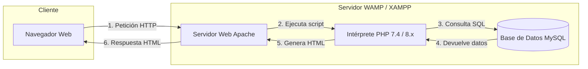

# 1.1 Servidor de Desarrollo XAMPP

Para desarrollar y probar aplicaciones web dinámicas basadas en lenguaje de servidor (PHP) y bases de datos relacionales (MySQL) antes de su publicación en un hosting de producción, es necesario montar un **entorno de servidor local**. En este tema abordaremos el despliegue de la pila **WAMP/LAMP** utilizando **XAMPP Portable**.

---

## 1. Arquitectura Web Cliente-Servidor y Pila WAMP

Las aplicaciones web dinámicas funcionan bajo el modelo **Cliente-Servidor**. El navegador del usuario (*Cliente*) realiza peticiones mediante el protocolo **HTTP/HTTPS** al *Servidor Web*, el cual procesa la lógica en lenguaje PHP, consulta la Base de Datos y devuelve una respuesta estructurada en HTML, CSS y JavaScript.

### Componentes de la Pila XAMPP:
* **X (Multiplataforma):** Funciona en Windows, Linux y macOS.
* **A (Apache):** Servidor HTTP encargado de atender las peticiones web y servir las páginas.
* **M (MariaDB / MySQL):** Sistema Gestor de Bases de Datos Relacionales (SGBD) donde se almacena la información.
* **P (PHP):** Lenguaje de programación ejecutable en el servidor (*Server-Side Scripting*).
* **P (Perl):** Lenguaje de programación interpretado para automatización de scripts.
* **phpMyAdmin:** Aplicación web integrada para la administración gráfica de bases de datos MySQL.

---

## 2. Ventajas de XAMPP Portable en Entornos de Aula

En los talleres e instalaciones técnicas del **Colegio Altair**, se utiliza la versión **XAMPP Portable** en lugar del instalador ejecutable (`.exe`) estándar por las siguientes razones técnicas:

1. **Sin permisos de administración:** No requiere privilegios de Administrador del sistema para escribir en el registro de Windows.
2. **Sin conflictos de registro:** No modifica las variables de entorno del sistema ni satura el registro de la máquina.
3. **Portabilidad total:** Se puede mover la carpeta raíz `C:\xampp` a cualquier otra ubicación o unidad externa manteniendo la configuración intacta.

---

## 3. Despliegue y Gestión de Servicios

### 3.1 Instalación en la Ruta Raíz
* Descomprimir la versión portable directamente en la raíz de la unidad del sistema: **`C:\xampp\`**.
* **Precaución:** Evitar instalar en rutas con espacios o caracteres especiales (ej. `C:\Program Files\xampp`) para prevenir fallos de ejecución en Apache.

### 3.2 Puertos de Red Predeterminados:
Para verificar que los servicios arrancan correctamente en el panel de control (`xampp-control.exe`), se deben monitorizar sus puertos de escucha:
* **Apache:** Puerto **80** (HTTP) y puerto **443** (HTTPS).
* **MySQL:** Puerto **3306** (SQL).

::: warning Conflictos de Puertos
Si Apache no arranca, suele deberse a que otra aplicación (como Skype, VMware o IIS) está ocupando el puerto 80. En ese caso, se debe modificar el archivo `httpd.conf` para cambiar el port de escucha a `8080`.
:::

---

## 4. Creación de la Base de Datos en phpMyAdmin

Antes de desplegar cualquier CMS, se debe preparar su base de datos contenedora desde `http://localhost/phpmyadmin`:

1. Acceder a la pestaña **Bases de datos**.
2. Asignar un nombre identificativo limpio (ej. `bd_wordpress_altair`).
3. Seleccionar el cotejo **`utf8mb4_unicode_ci`**:
    * Garantiza soporte completo para caracteres en español (*acentos, 'ñ'*) y emoticonos multibyte.

---

## 🧪 Práctica Guiada de Aula: Montaje del Servidor Local

::: info 📌 Hito Evaluable en Google Classroom
Una vez completada la comprobación del servidor local, debes subir las capturas de pantalla requeridas a la tarea **"Práctica 1.1: Despliegue de XAMPP Portable"** en Google Classroom para su calificación.
:::

### Objetivos:
Desplegar la versión portable de XAMPP, verificar el funcionamiento de los puertos de red y crear la base de datos inicial.

### Pasos a realizar:

1. **Descompresión y Ejecución:**
    * Ubica el archivo portable descargado y descompímelo en `C:\xampp`.
    * Abre `xampp-control.exe`.
2. **Arranque de Servicios:**
    * Haz clic en **Start** en los módulos de **Apache** y **MySQL**.
    * Verifica que ambos indicadores cambien a color verde y muestren los puertos `80/443` y `3306`.
3. **Comprobación Web:**
    * Abre el navegador y accede a `http://localhost`. Debe cargar la página de bienvenida de XAMPP.
4. **Creación de Base de Datos:**
    * Entra en `http://localhost/phpmyadmin`.
    * Crea la base de datos `bd_wordpress_altair` con cotejo `utf8mb4_unicode_ci`.
5. **Evidencia para Classroom:**
    * Captura el panel de XAMPP con los servicios en verde y la interfaz de phpMyAdmin mostrando la base de datos creada.
