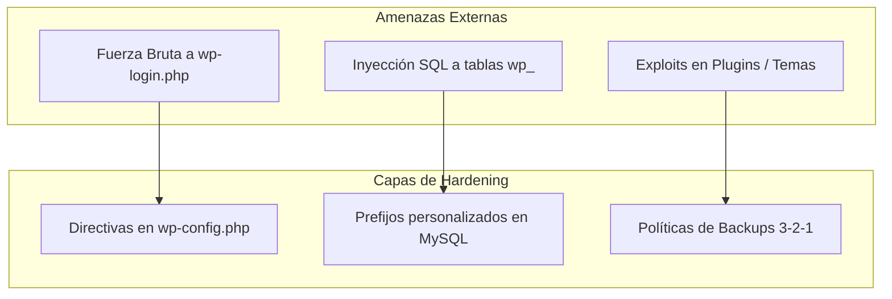

# 1.10 Seguridad Web, Hardening y Copias de Seguridad

Un administrador de sistemas microinformáticos no solo debe saber desplegar un gestor de contenidos, sino garantizar la integridad, confidencialidad y disponibilidad de la información frente a ciberataques, caídas de servicio o errores humanos. En este tema abordaremos las directivas de robustecimiento técnico (**Hardening**) y las estrategias profesionales de **Copia de Seguridad y Restauración (Backup & Disaster Recovery)** en WordPress.

---

## 1. Vectores de Ataque Habituales en CMS

Debido a su cuota de mercado global, WordPress es un objetivo preferente de ciberataques automatizados (*bots*). Los vectores más frecuentes son:

* **Ataques de Fuerza Bruta:** Intentos masivos y continuos de autenticación contra la ruta estándar `wp-login.php` o el endpoint XML-RPC (`xmlrpc.php`).
* **Inyección SQL (SQLi):** Explotación de vulnerabilidades en plugins desactualizados para ejecutar consultas maliciosas asumiendo la nomenclatura por defecto de las tablas de la base de datos (`wp_`).
* **Cross-Site Scripting (XSS):** Inserción de scripts maliciosos en campos no saneados de comentarios o formularios.
* **Denegación de Servicio (DoS por agotamiento de recursos):** Saturación de peticiones que colapsan la memoria RAM asignada al proceso PHP o saturan las conexiones de MySQL.


## 2. Robustecimiento Técnico (Hardening) en wp-config.php
El archivo wp-config.php reside en la raíz de la instalación y contiene las directivas operativas que gobiernan la ejecución de PHP y la interacción con la base de datos
. Aplicar medidas de hardening antes de la línea /* That's all, stop editing! */ permite mitigar riesgos sin recurrir necesariamente a plugins pesados
:
``` php
// 1. Aumentar el límite de memoria asignada a PHP para evitar cuellos de botella
define('WP_MEMORY_LIMIT', '256M');

// 2. Limitar el número de revisiones de entradas guardadas en BD (ahorro y optimización de MySQL)
define('WP_POST_REVISIONS', 3);

// 3. Modificar el intervalo de guardado automático a 120 segundos
define('AUTOSAVE_INTERVAL', 120);

// 4. Activar el registro de errores para auditoría interna sin exponer fallos en pantalla pública
define('WP_DEBUG', true);
define('WP_DEBUG_LOG', true);
define('WP_DEBUG_DISPLAY', false);

// 5. Deshabilitar el editor interno de código de plugins y temas desde el Escritorio
define('DISALLOW_FILE_EDIT', true);

```
::: warning 
🛡️ Ocultación de Errores (Information Disclosure) Mantener WP_DEBUG_DISPLAY en false mientras se audita con WP_DEBUG_LOG en true es una regla de seguridad crítica: impide que ante una caída de la base de datos o un fallo de código se muestren rutas absolutas del servidor (C:\xampp\...) al usuario público
, guardándolas únicamente en el archivo protegido wp-content/debug.log. 
:::
## 3. Seguridad en la Base de Datos: Prefijos Personalizados
Por defecto, el núcleo de WordPress crea 12 tablas con el prefijo wp_ (por ejemplo: wp_users, wp_posts, wp_options)
. Los scripts automatizados de inyección SQL suelen estar programados para atacar directamente estas tablas estándar
.
Pasos para personalizar el prefijo en phpMyAdmin:
1. **Sincronización en ```wp-config.php```:** Cambiar la variable de prefijo antes de la instalación (o tras renombrar las tablas)
:
``` php
\$table_prefix = 'alt_'; // Cambiado de 'wp_' a 'alt_'
```
2. **Renombrado de tablas en MySQL:** Si el sitio ya estaba instalado, se deben renombrar las tablas desde phpMyAdmin mediante sentencias ```RENAME TABLE```
.
3. **Mantenimiento y Desfragmentación:** Tras realizar modificaciones masivas, seleccionar todas las tablas en phpMyAdmin y ejecutar la orden ```Optimizar la tabla``` para reconstruir los índices y liberar espacio residual en disco
.
## 4. Estrategia de Copias de Seguridad (Backups)
Una copia de seguridad completa de WordPress requiere obligatoriamente dos componentes independientes
:
| Componente | Qué contiene | Dónde reside | Método de Extracción |
| --- | --- | --- | --- |
| Archivos Web | Núcleo, temas, plugins y subidas multimedia (uploads). | Directorio local C:\xampp\htdocs\mi_sitio_wordpress\ | Empaquetado en un archivo comprimido .zip o .tar.gz. |
| Base de Datos | Entradas, páginas, usuarios, opciones del sitio y contraseñas cifradas. | Gestor de base de datos MySQL (bd_wordpress_altair). | Volcado de texto plano en formato .sql exportado desde phpMyAdmin. |
::: tip 
📦 Regla del 3-2-1 para Backups Corporativos
Guarda al menos 3 copias de tus datos.
En 2 soportes o medios diferentes (disco duro local y unidad de red/nube).
Con al menos 1 copia fuera del servidor de desarrollo (almacenamiento externo desconectado). 
:::
## 🧪 Práctica Guiada de Aula: Hardening de Servidor y Respaldo Completo
::: info 
📌 Hito Evaluable en Google Classroom Una vez aplicadas las directivas de seguridad y exportada la base de datos, adjunta los comprobantes requeridos a la tarea "Práctica 1.10: Hardening y Backups en WordPress" en Google Classroom. 
:::
### Objetivos:
Editar el archivo wp-config.php para incorporar directivas de hardening
, realizar una exportación lógica completa de la base de datos en phpMyAdmin
 y generar una copia comprimida de los archivos de la aplicación
.
### Pasos a realizar:
1. Hardening en wp-config.php:
    * Abre ```C:\xampp\htdocs\mi_sitio_wordpress\wp-config.php``` con Visual Studio Code
.
   * Localiza la línea ```/* That's all, stop editing! Happy publishing. */```
   .
   * Inserta inmediatamente antes las siguientes directivas
   :
```php
   define('WP_MEMORY_LIMIT', '256M');
   define('WP_POST_REVISIONS', 3);
   define('AUTOSAVE_INTERVAL', 120);
   define('WP_DEBUG', true);
   define('WP_DEBUG_LOG', true);
   define('WP_DEBUG_DISPLAY', false);
   define('DISALLOW_FILE_EDIT', true);
```

* Guarda los cambios
   . Comprueba en el escritorio de WordPress que en el menú ```Apariencia``` y ```Plugins``` ha desaparecido la opción del editor de archivos por motivos de seguridad. 
2. Volcado Lógico de Base de Datos (Backup SQL):
    * Accede a ```http://localhost/phpmyadmin```
.
    * Selecciona tu base de datos de WordPress (```bd_wordpress_altair```).
    * Pulsa en la pestaña **Exportar**.
    * Selecciona el método de exportación Rápido y formato **SQL**.
    * Haz clic en **Exportar** y guarda el archivo `.sql` generado en una carpeta segura de tu equipo.
3. Respaldo de Archivos Web:
   * Detén temporalmente el servicio Apache desde el panel de control de XAMPP
   .
   * Navega a `C:\xampp\htdocs\`
   .
   * Haz clic derecho sobre tu carpeta `mi_sitio_wordpress` y comprímela en un archivo `.zip` (ej. ```backup_archivos_wordpress.zip```).
   * Vuelve a iniciar Apache en XAMPP
   .
4. Evidencias para Classroom:
   * Captura 1: Las directivas añadidas en ```wp-config.php``` visualizadas en VS Code
   .
   * Captura 2: El archivo ```.sql``` de la base de datos descargado junto al archivo ```.zip``` con el respaldo de archivos en una misma carpeta.

---
