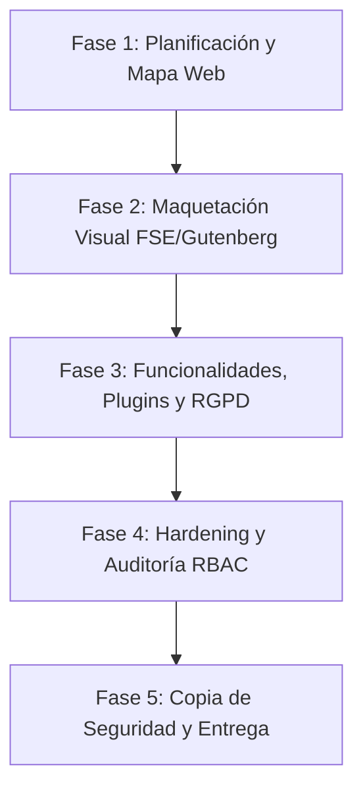

# 1.11 Proyecto Guiado: Mi Primera Web Corporativa Completa

Este proyecto integrador constituye la prueba práctica de consolidación del **Bloque 1**. En él, el alumnado aplicará de forma combinada los conocimientos adquiridos sobre arquitectura cliente-servidor, despliegue en XAMPP, maquetación con bloques Gutenberg, gestión de contenidos, auditoría de roles RBAC, integración de plugins y *hardening* de seguridad en WordPress.

---

## 1. Planteamiento del Caso Práctico Corporativo

El departamento de sistemas del **Colegio Altair** ha encomendado al equipo de técnicos en *Sistemas Microinformáticos y Redes (SMR)* el diseño, despliegue y aseguramiento del nuevo portal web corporativo para una PYME de soluciones informáticas ficticia (**"Altair Tech Solutions"**).

El sitio web debe servir como escaparate comercial de la empresa, canal de captación de clientes mediante formularios compatibles con la normativa europea de protección de datos (**RGPD**), altavoz para noticias técnicas y plataforma segura con perfiles de acceso restringidos para el personal.

---

## 2. Mapa de Fases del Proyecto

El desarrollo del proyecto sigue la metodología de trabajo por hitos secuenciales utilizada en entornos profesionales de TI:

## 3. Especificaciones Técnicas por Fases
### Fase 1: Arquitectura de la Información y Mapa Web
1. Configuración de lectura (Ajustes > Lectura): Establecer una página estática para la Portada (Inicio) y una página dedicada (Noticias) para la parrilla del Blog.
2. Estructura de URLs amigables (Ajustes > Enlaces permanentes): Activar la estructura basada en /nombre-post/.
3. Estructura de 5 Páginas Clave:
   - Inicio (Portada): Banner principal con llamada a la acción (CTA), resumen de servicios en columnas y testimonio de clientes.
   - Quiénes Somos: Presentación del equipo técnico de SMR, misión de la empresa y valores corporativos.
   - Servicios: Detalle técnico de soluciones (Mantenimiento de Redes, Montaje de Equipos y Desarrollo Web).
   - Noticias / Blog: Categorías organizadas (Redes, Sistemas, Seguridad) con al menos 3 entradas de prueba redactadas.
   - Contacto: Dirección física, mapa de ubicación y formulario de contacto.
### Fase 2: Maquetación Visual con Gutenberg y FSE
- Cabecera y Pie de Página: Personalizar el encabezado con el logotipo y el menú principal de navegación. En el pie de página, incluir el menú legal (Aviso Legal, Política de Privacidad) y créditos.
- Maquetación con Bloques Avanzados:
  - Uso de bloques de Columnas (33/33/33 %) para presentar los tres servicios principales.
  - Uso de bloque Medios y Texto alineado a ancho amplio en la sección "Quiénes Somos".
  - Integración de botones de llamada a la acción (CTA).
### Fase 3: Integración de Funcionalidades y Formularios (RGPD)
* Plugin de Formularios: Instalar y activar un plugin de formularios (ej. WPForms, Forminator o Fluent Forms).
* Campos del Formulario de Contacto:
  1. Nombre y Apellidos (Obligatorio).
  2. Email Corporativo (Obligatorio, con validación de formato).
  3. Área de Texto para la Consulta (Obligatorio).
  4. Casilla de verificación RGPD con el texto obligatorio: "He leído y acepto la política de privacidad".
  5. Menús de Navegación: Asignación correcta de menú principal y menú de pie de página en Apariencia > Menús o en el Editor del Sitio.
### Fase 4: Hardening de Seguridad y Auditoría RBAC
* Directivas en wp-config.php:
  - Límite de memoria PHP a 256 MB (WP_MEMORY_LIMIT).
  - Desactivación del editor interno de código de plugins y temas (DISALLOW_FILE_EDIT).
  - Activación de log de depuración seguro (WP_DEBUG_LOG).
* Matriz de Usuarios RBAC:
  - Mantener la cuenta del Administrador (admin_altair).
  - Crear un usuario Editor (editor_altair) para validar y publicar noticias.
  - Crear un usuario Autor (autor_altair) para redactar entradas técnicas.
  - Crear un usuario Colaborador (colaborador_altair) para redactar borradores.
### Fase 5: Estrategia de Backup y Verificación
*   Volcado Lógico de BD: Exportación de la base de datos bd_wordpress_altair en formato .sql desde phpMyAdmin.
*   Respaldo de Archivos: Compresión del directorio C:\xampp\htdocs\mi_sitio_wordpress\ en formato .zip.
## 🧪 Hito Evaluables de Aula: Entrega del Proyecto Integrador
::: info 
📌 Hito Final en Google Classroom El proyecto se entregará adjuntando en la tarea "Proyecto Integrador Bloque 1: Web Corporativa Completa" de Google Classroom el archivo de respaldo .zip, el archivo .sql de la base de datos y la memoria técnica con la lista de comprobaciones en PDF. 
:::
#### Lista de Comprobación (Checklist) de Pre-Lanzamiento:
1. [ ] Servidor local iniciado correctamente en XAMPP (Apache en puerto 80/443 y MySQL en puerto 3306).
2. [ ] Portada estática y página de noticias configuradas en Ajustes > Lectura.
3. [ ] Enlaces permanentes en estructura amigable (/nombre-post/).
4. [ ] 5 páginas corporativas maquetadas con Gutenberg (Portada, Quiénes Somos, Servicios, Noticias, Contacto).
5. [ ] Formulario de contacto funcional con casilla de verificación RGPD.
6. [ ] Menú de navegación principal y secundario asignados correctamente.
7. [ ] Directivas de hardening agregadas en wp-config.php (VS Code).
8. [ ] 4 usuarios creados en WordPress representando la matriz de roles RBAC.
9. [ ] Copia de seguridad comprimida (.zip) y volcado de la base de datos (.sql) generados.
---
