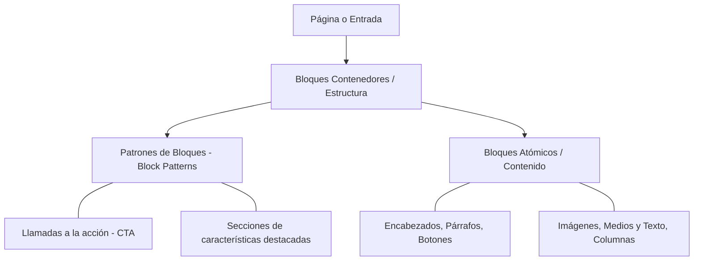

# 1.8 Personalización Visual: Temas, Bloques y FSE

La apariencia y estructura visual de WordPress ha evolucionado desde las plantillas estáticas tradicionales en código PHP hacia un paradigma declarativo y modular basado en bloques (**Gutenberg**) y la edición integral del sitio (**FSE** - *Full Site Editing*) [1, 2]. Comprender esta arquitectura permite personalizar la interfaz según los requerimientos del proyecto corporativo sin necesidad de programar desde cero [2, 3].

---

## 1. Temas Clásicos vs. Temas de Bloques (FSE)

En el ecosistema actual de WordPress conviven dos arquitecturas de diseño visual claramente diferenciadas:

| Característica | Temas Clásicos (*Classic Themes*) | Temas de Bloques / FSE (*Block Themes*) |
| :--- | :--- | :--- |
| **Pila de Plantillas** | Archivos en lenguaje PHP (`header.php`, `footer.php`, `sidebar.php`). | Plantillas declarativas basadas en HTML semántico y bloques en formato JSON (`templates/index.html`). |
| **Herramienta de Personalización** | Menú `Apariencia > Personalizar` (*Customizer*) y `Apariencia > Widgets`. | Menú único `Apariencia > Editor` (*Site Editor*). |
| **Control de Cabecera y Pie** | Rígido; fijado directamente por el código PHP del desarrollador del tema. | Totalmente visual; editable directamente como bloques de partes de plantilla (*Template Parts*). |
| **Estilos Globales** | Definidos en la hoja de estilos externa `style.css`. | Centralizados en el archivo estándar `theme.json` (paletas de color, tipografías y espaciados). |
| **Rendimiento (WPO)** | Frecuente sobrecarga de scripts y librerías externas. | Carga selectiva de CSS únicamente para los bloques presentes en la página actual. |

::: tip 💡 Tendencia y Estándar
Desde las versiones modernas de WordPress (como las familias 6.x y temas oficiales tipo *Twenty Twenty-Four*), el estándar recomendado para nuevos desarrollos es el uso de **Temas de Bloques**, ya que unifican la maquetación del contenido y la estructura global del portal bajo una misma interfaz.
:::

---

## 2. Jerarquía del Editor de Bloques Gutenberg

El editor Gutenberg estructura la información de manera modular y jerárquica mediante tres capas de diseño:

### 2.1 Bloques Atómicos Fundamentales:
* **Estructura y Maquetación:**
  * Grupo (Group): Contenedor genérico para agrupar varios bloques y aplicarles un fondo, margen interno (padding) o borde unificado.
  * Columnas (Columns): Permite dividir el espacio horizontal en rejillas (grids) proporcionales (ej. 50/50 %, 33/33/33 %, 70/30 %).
* **Contenido y Medios:**
  * Medios y Texto (Media & Text): Presenta una imagen y un bloque de texto alineados horizontalmente en paralelo, con opción de apilamiento responsivo en dispositivos móviles.
  * Botones (Buttons): Elementos de enlace destacados orientados a conversiones o llamadas a la acción (CTA - Call to Action).
### 2.2 Patrones de Bloques (Block Patterns):
  Son composiciones prediseñadas y reutilizables formadas por múltiples bloques ya ajustados (por ejemplo: secciones de testimonios, tablas de precios o cabeceras promocionales)
  . Permiten agilizar el diseño manteniendo la coherencia de estilos en todo el portal.
## 3. Arquitectura del Editor del Sitio (Full Site Editing)
Al trabajar con un tema de bloques activo, la sección Apariencia > Editor permite modificar directamente las áreas estructurales globales que antes requerían editar código PHP
:
1. **Partes de Plantilla (Template Parts):**
    * Cabecera (Header): Logotipo del sitio, título corporativo y menú de navegación principal.
    * Pie de página (Footer): Avisos legales, créditos del centro o empresa, accesos a redes sociales y mapa web secundario.
2. **Plantillas del Sistema (Templates):**

    * index.html: Plantilla de reserva predeterminada para cualquier contenido.
    * single.html: Estructura para la visualización de una entrada de blog individual.
    * page.html: Estructura para páginas estáticas institucionales. 
    * 404.html: Página de error mostrada cuando una URL no existe.
3. **Estilos Globales (Global Styles):**
   * Permite definir la tipografía global (fuente, escala de tamaños), los colores de la marca y las dimensiones de maquetación (ancho del contenedor principal y ancho ampliado) aplicables a todos los bloques sin escribir código CSS.
## 🧪 Práctica Guiada de Aula: Maquetación Avanzada y Personalización de Plantilla
   ::: info 📌 Hito Evaluable en Google Classroom Una vez completada la maquetación de la página y los ajustes visuales, adjunta las evidencias gráficas a la tarea "Práctica 1.8: Maquetación con Bloques y Estilos FSE" en Google Classroom.
   :::
   ### Objetivos:
   Maquetar una página corporativa estructurada utilizando bloques avanzados de Gutenberg y personalizar elementos de plantilla mediante el Editor del Sitio.
   ### Pasos a realizar:
   1. Creación de la Página Institucional:
      * Accede a Páginas > Añadir nueva y nómbrala: Oferta Educativa SMR - Altair
      .
   2. Inserción de Bloque "Medios y Texto":
      * Añade un bloque de Medios y Texto alineado a ancho amplio o completo
      .
      * En la columna de medios, sube una imagen optimizada del aula técnica; en la columna de texto, añade un encabezado H2 y una breve descripción del Ciclo de Grado Medio de SMR
      .
   3. Estructura en Rejilla de 3 Columnas:
      * Inserta un bloque de Columnas con distribución al 33 % cada una
      .
      * Maqueta tres tarjetas informativas describiendo tres módulos clave del ciclo formativo
      :
        * Columna 1: Redes Locales
        .
        * Columna 2: Montaje y Mantenimiento de Equipos
        .
        * Columna 3: Aplicaciones Web
        .
   4. Patrón de Llamada a la Acción (CTA):
      * Añade al final de la página un Patrón de Bloques de llamada a la acción o inserta un bloque de Botón centrado con el texto "Solicitar Información de Matrícula"
      .
   5. Ajustes en el Editor del Sitio (FSE):
      * Accede a Apariencia > Editor > Estilos y personaliza la paleta cromática o el tamaño y peso de los encabezados del sitio
      .
   6. Evidencias para Classroom:
      * Sube una captura del diseño en la parte pública del navegador (Frontend) donde se aprecie la página completa maquetada y funcional
      .

---
