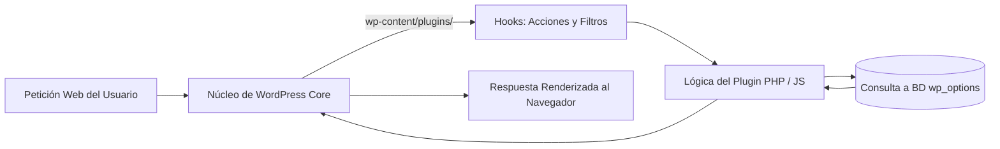

# 1.9 Ecosistema de Plugins: Formularios y Utilidades

El núcleo (*Core*) de WordPress está diseñado de forma intencionada para ser ligero y eficiente. Cualquier funcionalidad adicional —desde un formulario de contacto hasta mecanismos de optimización de rendimiento o integración con servicios externos— se añade mediante **Plugins** (módulos de extensión). Como futuros administradores de sistemas, es fundamental conocer su arquitectura interna, criterios de selección profesional y riesgos de mantenimiento.

## 1. Arquitectura y Ciclo de Vida de un Plugin

Un plugin es un conjunto de scripts en PHP, acompañados de hojas de estilo CSS y scripts JavaScript, que interactúan con el núcleo de WordPress sin alterar sus archivos originales:

* **Ubicación en el servidor:** Se instalan en el directorio `wp-content/plugins/`. Cada plugin se aloja en su propia subcarpeta.
* **Sistema de *Hooks* (Ganchos):** Los plugins se acoplan al ciclo de vida de la ejecución mediante:
    * **Acciones (*Action Hooks*):** Ejecutan funciones en momentos específicos (por ejemplo, al guardar una entrada o enviar un correo).
    * **Filtros (*Filter Hooks*):** Modifican datos o contenido antes de guardarlos en la base de datos o mostrarlos en pantalla.
* **Persistencia:** Las configuraciones y opciones del plugin se almacenan en la tabla `wp_options` o en tablas dedicadas creadas en la base de datos MySQL.

## 2. Criterios de Selección y Auditoría de Plugins
Instalar plugins de forma indiscriminada puede generar vulnerabilidades de seguridad (exploits), incompatibilidades de código o una degradación crítica de la velocidad de carga (WPO).
Antes de incorporar un plugin al repositorio oficial desde Plugins > Añadir nuevo, se debe auditar la siguiente lista de control técnico:
| Criterio de Auditoría | Indicador Óptimo | Riesgo / Advertencia |
| --- | --- | --- |
| Compatibilidad | "Compatible con tu versión de WordPress" | Incompatibilidad con las últimas APIs del core. |
| Última Actualización | Hace menos de 3 a 6 meses | Posible proyecto abandonado sin parches de seguridad. |
| Instalaciones Activas | Miles o millones de instalaciones | Cuanto mayor sea la comunidad, más rápido se corrigen errores. |
| Valoraciones y Soporte | 4.5 o 5 estrellas; foro de soporte activo | Problemas recurrentes sin respuesta del desarrollador. |
| Impacto en Rendimiento | Código limpio y carga condicional de scripts | Inyección de librerías pesadas en todas las páginas del sitio. |
::: warning 
⚠️ Peligro: Plugins "Nulled" o Piratas 
Nunca se deben instalar plugins o temas comerciales descargados de fuentes no oficiales (nulled). En la mayoría de los casos contienen puertas traseras (backdoors), código malicioso ofuscado o scripts de inyección SQL diseñados para tomar el control del servidor local o remoto. 
:::
## 3. Integración de Formularios de Contacto
Una de las utilidades más demandadas en cualquier sitio web corporativo es el canal de comunicación bidireccional mediante formularios de contacto interactivos.
### 3.1 Anatomía de un Formulario Web
Un formulario corporativo estándar se compone de:
Campos de captura de datos: Nombre, correo electrónico, asunto, mensaje y casillas de verificación (checkbox).
Validación de datos (Client-Side & Server-Side): Comprobación de formatos de email correctos y campos de cumplimentación obligatoria.
Cláusula de Protección de Datos (RGPD): Casilla obligatoria desmarcada por defecto con enlace a la Política de Privacidad.
Disparador de Notificación: Envío del mensaje mediante la función wp_mail() al buzón del administrador y guardado de copia de seguridad en la base de datos.
### 3.2 Opciones Recomendadas en el Ecosistema
WPForms / Fluent Forms / Forminator: Constructores visuales de tipo arrastrar y soltar (drag-and-drop), ideales para maquetación rápida y configuración de notificaciones automáticas.
Contact Form 7: Solución clásica basada en etiquetas semánticas y códigos cortos (shortcodes), ligera y altamente personalizable para administradores técnicos.
## 4. Gestión Operativa de Plugins
Desde la sección Plugins > Plugins instalados, se gestionan sus tres estados operativos:
Activo: El código del plugin se carga e interpreta en cada petición HTTP.
Inactivo: Los archivos permanecen en el servidor (wp-content/plugins/), pero el núcleo no los ejecuta.
Eliminado: Borra físicamente la carpeta del plugin del disco y, en muchos casos, limpia sus tablas asociadas en la base de datos.
::: tip 
🧹 Buenas Prácticas de Mantenimiento Mantén activados únicamente los plugins indispensables para el funcionamiento del sitio. Un plugin inactivo no consume memoria RAM en la ejecución de PHP, pero sus archivos en disco siguen siendo susceptibles de contener vulnerabilidades si no se actualizan puntualmente. 
:::

# 🧪 Práctica Guiada de Aula: Despliegue de Formulario Corporativo
::: info 
📌 Hito Evaluable en Google Classroom Tras completar la integración del formulario y verificar su funcionamiento en la página de contacto, sube las capturas correspondientes a la tarea "Práctica 1.9: Ecosistema de Plugins y Formularios de Contacto" en Google Classroom. 
:::
## Objetivos:
Instalar un plugin de formularios desde el repositorio oficial, diseñar un formulario de contacto con validación de campos conforme al RGPD e incrustarlo en una página institucional del sitio.
## Pasos a realizar:
### 1. Instalación y Activación:
Accede al panel de administración como administrador.
Ve a Plugins > Añadir nuevo y busca un plugin de formularios de contacto (por ejemplo, Formulator o WPForms).
Haz clic en Instalar ahora y, a continuación, en Activar.
### 2. Construcción del Formulario de Contacto:
Accede al menú lateral del plugin y crea un nuevo formulario llamado: Formulario de Contacto - SMR.
Añade y configura los siguientes campos:
Nombre completo (Obligatorio).
Correo electrónico (Obligatorio, con validación de formato).
Teléfono de contacto (Opcional).
Mensaje / Consulta (Área de texto, obligatorio).
Consentimiento RGPD (Casilla obligatoria con el texto: "He leído y acepto la política de privacidad").
### 3. Incrustación en la Página de Contacto:
Ve a Páginas > Añadir nueva (o edita la página Contacto existente).
Inserta el formulario utilizando su Bloque nativo de Gutenberg o pegando su código corto (Shortcode).
Publica la página.
### 4. Comprobación Funcional en el Frontend:
Abre la página de contacto en el navegador.
Intenta enviar el formulario vacío para comprobar que el sistema bloquea el envío y avisa de los campos obligatorios.
Rellena un mensaje de prueba válido y envíalo.
### 5. Evidencias para Classroom:
* **Captura 1**: Panel de Plugins > Plugins instalados mostrando el plugin activo y actualizado.
* **Captura 2**: Vista pública del formulario en la página de contacto con el mensaje de confirmación de envío en pantalla.

---
