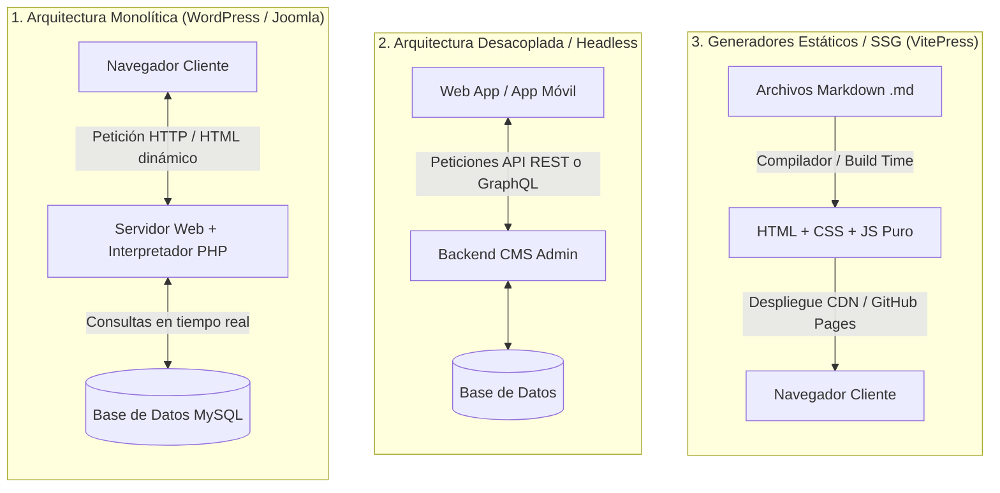

# 2.1 Panorama de los CMS: Monolíticos, Headless y Generadores Estáticos (SSG)

Un **Gestor de Contenidos** (*CMS - Content Management System*) es una plataforma software que permite crear, administrar, organizar y publicar información digital en la web sin necesidad de escribir código fuente individual para cada página.

Sin embargo, el ecosistema web actual ha evolucionado enormemente desde las arquitecturas dinámicas tradicionales hacia modelos desacoplados y generadores de código estático. Como técnicos en *Sistemas Microinformáticos y Redes*, es fundamental saber analizar e identificar qué arquitectura de CMS se adapta mejor a los requerimientos de cada proyecto profesional.

## 1. Clasificación por Propósito y Aplicación

Los CMS pueden clasificarse según la funcionalidad especializada para la que han sido diseñados:

| Tipo de CMS | Propósito Principal | Ejemplos Representativos |
| :--- | :--- | :--- |
| **Portales y Blogs** | Gestión de contenidos informativos, noticias, taxonomías y publicación periódica. | **WordPress**, Joomla!, Drupal |
| **E-Learning (LMS)** | Gestión de aulas virtuales, matriculación de alumnado, calificaciones y contenidos didácticos. | **Moodle**, Canvas, Chamilo |
| **Comercio Electrónico** | Gestión de catálogos de productos, carritos de compra, pasarelas de pago y stock. | **PrestaShop**, WooCommerce, Shopify |
| **Documentación y SSG** | Generación de manuales técnicos, documentación de proyectos y sitios ultrarrápidos. | **VitePress**, Astro, MkDocs |
| **Wikis / Conocimiento** | Edición colaborativa de artículos hipervinculados para bases de conocimiento interno. | **MediaWiki**, DokuWiki |

## 2. Paradigmas de Arquitectura Web

La estructura técnica que conecta la base de datos, la lógica del servidor y la interfaz pública (*frontend*) determina el rendimiento, la seguridad y la escalabilidad del sitio web:

### 2.1 Arquitectura Monolítica (Traditional CMS)
Es el modelo clásico (representado por WordPress, Joomla! o Drupal). En esta arquitectura, el Backend (panel de administración) y el Frontend (lo que ve el usuario) están íntimamente acoplados en el mismo servidor.

**Funcionamiento**: En cada petición web, el servidor procesa código PHP, ejecuta consultas a la base de datos MySQL y construye el código HTML "al vuelo" para enviarlo al navegador.

**Ventajas**: Facilidad de uso para usuarios no técnicos, amplio catálogo de plugins y administración unificada.

**Inconvenientes**: Mayor consumo de CPU/RAM en el servidor, dependencia de bases de datos y mayor superficie de ataque frente a vulnerabilidades como inyecciones SQL (SQLi) o scripts maliciosos (XSS).
### 2.2 Arquitectura Desacoplada (Headless CMS)
En un Headless CMS (como _Strapi_ o _Contentful_), el gestor de contenidos carece de plantilla gráfica pública (_head_). Su única función es almacenar y gestionar los datos, ofreciéndolos al exterior a través de una API REST o GraphQL.

**Funcionamiento**: El equipo de desarrollo puede crear múltiples interfaces web o aplicaciones móviles (usando React, Vue o Svelte) que consumen los contenidos expuestos por la API del CMS central.

**Ventajas**: Omnicanalidad (el mismo contenido sirve para una web, un reloj inteligente y una app móvil) y separación absoluta entre el diseño y los datos.

**Inconvenientes**: Requiere conocimientos avanzados de programación de API y maquetación frontend.
### 2.3 Generadores de Sitios Estáticos (SSG - Jamstack)
Los Generadores de Sitios Estáticos (como VitePress, Astro o Hugo) representan la tendencia moderna para la documentación técnica y portales corporativos ligeros.

**Funcionamiento**: Los contenidos se redactan en archivos de texto plano utilizando sintaxis Markdown (.md). Durante la fase de compilación (build time), la herramienta genera una colección de archivos HTML, CSS y JS planos y optimizados.

**Ventajas**:
* _Velocidad WPO Extrema_: Al no haber PHP ni consultas a bases de datos en tiempo de ejecución, la carga es instantánea.
* _Seguridad Absoluta_: No existe base de datos MySQL que consultar ni scripts PHP que explotar en el servidor. 
* _Alojamiento Gratuito/Económico_: Se pueden alojar en redes de distribución de contenido (CDN) o servicios como GitHub Pages, Vercel o Netlify.

**Inconvenientes**: Requiere compilar el sitio tras cada cambio de contenido y carece de panel gráfico nativo para usuarios no técnicos.

## 3. Matriz Comparativa de Arquitecturas
| Criterio Técnico | Monolítico (ej. WordPress) | Headless (ej. Strapi) | SSG (ej. VitePress) |
| :--- | :--- | :--- | :--- |
| Procesamiento en Servidor | Dinámico en cada petición HTTP | Dinámico bajo demanda por API | Inexistente (Archivos pre-renderizados) |
| Base de Datos | Relacional obligatoria (MySQL/MariaDB) | Relacional o NoSQL | Ninguna (Archivos Markdown .md) |
| Velocidad de Carga (WPO) | Media / Alta (requiere caché) | Alta | Extrema (Insuperable) |
| Superficie de Seguridad | Vulnerable si no se actualiza | Media (restringida a la API) | Mínima / Nula (Sin BD ni PHP) |
| Curva de Aprendizaje | Muy baja (Panel intuitivo) | Alta (Desarrollo Frontend) | Media (Manejo de Markdown y Git) |
| Coste de Infraestructura | Servidor con PHP y MySQL | Servidor de aplicaciones/API | Alojamiento gratuito en CDN / GitHub |
