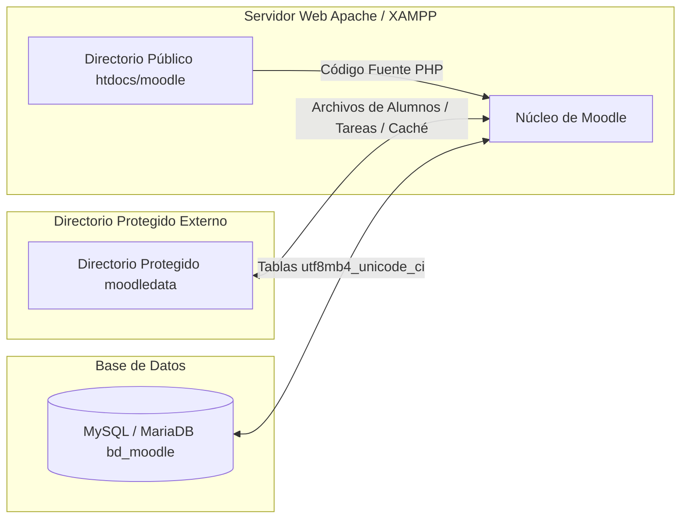

# 2.2 Plataformas LMS: Despliegue y Cursos en Moodle

Un **Sistema de Gestión del Aprendizaje** (*LMS - Learning Management System*) o **Entorno Virtual de Aprendizaje (EVA)** es una plataforma web diseñada para crear, administrar y distribuir actividades formativas a distancia o como soporte a la enseñanza presencial.

En el ámbito educativo público y profesional de Andalucía (como la plataforma *Moodle Centros* de la Junta de Andalucía), **Moodle** (*Modular Object-Oriented Dynamic Learning Environment*) se consolida como el estándar absoluto. En este tema abordaremos su arquitectura de servidor, requisitos de pre-instalación en XAMPP, despliegue, gestión académica y políticas de respaldo.

---

## 1. Arquitectura de Servidor en Moodle

A diferencia de un CMS tradicional como WordPress, Moodle impone requisitos de servidor y políticas de seguridad en disco más estrictas debido al volumen de archivos de tareas, registros de actividad y consultas concurrentes a la base de datos.


### 1.1 El Directorio de Datos Separado (moodledata)
Por motivos críticos de seguridad, Moodle exige que los archivos subidos por el alumnado (tareas, documentos, exámenes) y las carpetas de caché se almacenen en un directorio denominado `moodledata` situado fuera de la raíz pública del servidor web (`htdocs`).

_En XAMPP local_: Si el código web reside en `C:\xampp\htdocs\moodle\`, el directorio de datos debe crearse en `C:\xampp\moodledata\`. Esto impide que un atacante pueda ejecutar scripts maliciosos subidos dentro de una entrega de tarea accediendo directamente vía URL HTTP.

---

## 2. Auditoría de Requisitos en php.ini y MySQL
Antes de ejecutar el instalador web de Moodle, es imprescindible ajustar el entorno PHP en XAMPP para evitar bloqueos del sistema durante la instalación de las tablas.
### 2.1 Extensiones PHP Obligatorias (php.ini)
Se deben desmarcar (quitar el punto y coma `;` inicial) las siguientes extensiones en `C:\xampp\php\php.ini`:

```
extension=intl
extension=soap
extension=sodium
extension=opcache
extension=gd
extension=zip
```

### 2.2 Directivas de Rendimiento y Búsqueda
En el mismo archivo `php.ini`, se deben actualizar los siguientes valores:
```
max_input_vars = 5000
memory_limit = 256M
upload_max_filesize = 64M
post_max_size = 64M
```

### 2.3 Base de Datos dedicada en phpMyAdmin
Crear la base de datos **bd_moodle** asegurando el cotejo multilingüe completo:

`Nombre de BD: bd_moodle`

`Cotejo (Collation): utf8mb4_unicode_ci`

---
## 3. Matriz de Roles y Estructura Académica
Moodle organiza el aprendizaje mediante una jerarquía estricta de contenedores y permisos por contexto:

```
CATEGORÍA PADRE (ej. Formación Profesional)
    └── SUBCATEGORÍA (ej. Informática y Comunicaciones)
                └── SUBCATEGORÍA NIVEL 2 (ej. 2º SMR - Grado Medio)
                                └── CURSO VIRTUAL (ej. Aplicaciones Web - 2026/2027)
```

## 3.1 Matriz de Roles Nativos en Moodle

| Rol en Moodle | Ámbito / Contexto | Capacidades Clave | 
| ------------- | ----------------- | ----------------- |
| Administrador |  Global (Todo el sitio) | Control total: instalar plugins, configurar ajustes del servidor, crear categorías y asignar roles. |
| Gestor (Manager) | Categoría o Sitio | Puede crear cursos, matricular usuarios y gestionar categorías sin acceder a la configuración del servidor. |
| Creador de Cursos | Categoría asignada | Puede crear nuevos cursos dentro de una categoría específica y actuar como profesor en ellos. |
| Profesor | Curso individual | Puede gestionar contenidos, editar actividades, calificar tareas y matricular alumnado dentro de su curso. |
| Profesor sin permiso de edición | Curso individual | Puede tutorizar, calificar tareas y responder en foros, pero no puede modificar la estructura ni las actividades del curso. |
| Estudiante | Curso individual | Puede acceder a los recursos, enviar tareas, realizar cuestionarios y consultar su libro de calificaciones personal. |


## 4. Recursos, Actividades y Evaluación
Dentro de un curso de Moodle, los elementos pedagógicos se dividen en dos categorías principales:
* Recursos (Estáticos): Elementos de consulta para el alumnado.
  * Archivo / Carpeta: Documentos PDF, presentaciones o agrupaciones de ficheros.
  * Página / Libro: Contenido web maquetado directamente en Moodle estructurado por capítulos.
  * URL: Enlaces externos a documentación o repositorios.
* Actividades (Interactivas y Evaluables): 
  * Elementos que requieren la acción o entrega del estudiante. 
  * Tarea: Recepción de trabajos en formato digital con límite de fecha, retroalimentación y rúbrica de calificación. 
  * Cuestionario: Exámenes autoevaluables con bancos de preguntas (opción múltiple, verdadero/falso, emparejamiento) y corrección automática.
  * Foro: Canal de debate asíncrono para dudas, avisos o evaluación continua.
---
## 5. Mantenimiento y Copias de Seguridad de Cursos (.mbz)
Moodle permite empaquetar cursos completos para su migración, archivo o restauración mediante archivos en formato propietario comprimido .mbz.

+ Tipos de Respaldo:
  * Copia de Seguridad del Curso (.mbz): Incluye la estructura, recursos, actividades y banco de preguntas (opcionalmente puede incluir o excluir los datos y entregas de los estudiantes).
  * Restauración / Importación: Permite volcar el contenido de un archivo .mbz en un curso nuevo o fusionar contenidos en un curso existente.
