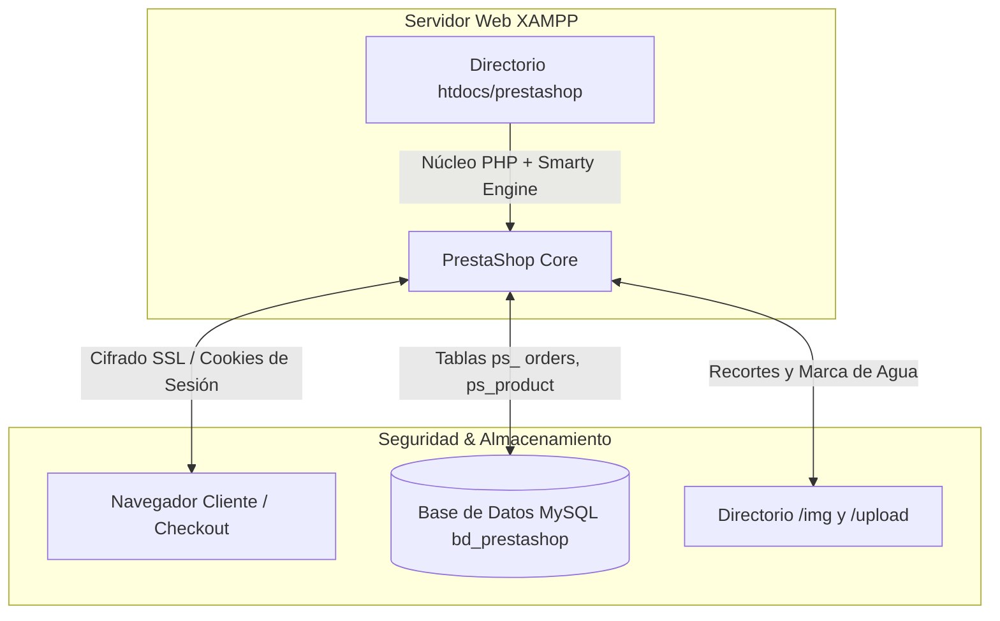

# 2.3 CMS E-Commerce: Gestión de Tiendas con PrestaShop

El **comercio electrónico** (*E-Commerce*) exige arquitecturas de software capaces de gestionar transacciones económicas seguras, cálculo dinámico de impuestos, control estricto de inventario en tiempo real y comunicación continua con pasarelas de pago y operadores logísticos.

Aunque existen plugins que añaden funciones de tienda a CMS multipropósito (como *WooCommerce* sobre WordPress), plataformas nativas especializadas como **PrestaShop** están diseñadas desde su núcleo (*Core*) para gestionar grandes catálogos corporativos e integraciones profesionales ERP/CRM.

---

## 1. PrestaShop vs. Plugins de E-Commerce (WooCommerce)

Comprender las diferencias entre un gestor dedicado y una extensión sobre un CMS generalista es clave a la hora de asesorar a un cliente o empresa:

| Criterio Técnico | PrestaShop (CMS Especializado) | WooCommerce (Plugin sobre WordPress) |
| :--- | :--- | :--- |
| **Arquitectura de Base de Datos** | Tablas relacionales altamente optimizadas exclusivamente para ventas y stock (`ps_product`, `ps_orders`). | Almacena productos e historial como entradas en la tabla genérica `wp_posts` y `wp_postmeta`. |
| **Volumen de Catálogo** | Diseñado para escalar a decenas de miles de referencias (SKU) sin degradar el rendimiento. | Ideal para catálogos pequeños o medianos (hasta unos pocos miles de productos). |
| **Multitienda Nativa** | Soporta múltiples tiendas físicas/online desde un único panel de control (*Backoffice*). | Requiere configuraciones complejas (*WordPress Multisite*) o plugins adicionales. |
| **Gestión Fiscal y Multi-divisa** | Reglas de impuestos multinivel, recargo de equivalencia y conversión de divisas nativa. | Requiere extensiones adicionales para sistemas fiscales complejos. |
| **Curva de Aprendizaje** | Media/Alta; entorno orientado a la administración de ventas y logística. | Muy baja; aprovecha la interfaz conocida del escritorio de WordPress. |

---

## 2. Arquitectura de Servidor y Requisitos Técnicos

PrestaShop utiliza la pila **LAMP/WAMP** (Apache, MySQL/MariaDB y PHP), pero requiere módulos específicos habilitados en `php.ini` para procesar imágenes de productos y procesar pagos seguros:


## 2.1 Extensiones PHP Requeridas en php.ini
En el servidor de desarrollo XAMPP (C:\xampp\php\php.ini), deben estar activas las siguientes librerías:
```
extension=curl
extension=gd
extension=intl
extension=mbstring
extension=zip
extension=pdo_mysql
extension=fileinfo
```
# 2.2 Requisito Obligatorio de Seguridad en el Nombre del Backoffice
Por defecto, tras la instalación, PrestaShop bloquea la ejecución del sistema si se mantiene la carpeta `/admin` original. Por motivos de _hardening_, el instalador exige renombrar la carpeta de administración con una cadena alfanumérica única (por ejemplo, `admin_altair_2627`).
# 3. Estructura del Panel de Gestión (Backoffice)
El panel de administración de PrestaShop se organiza en tres grandes bloques operativos:
## 3.1 Gestión de Catálogo e Inventario (Vender > Catálogo)
* **Categorías y Árbol de Productos**: Estructura jerárquica para la navegación del cliente.
* **Tipos de Producto**:
  * _Producto estándar_: Físico con envío de paquetería y control de unidades en stock.
  * _Producto con combinaciones_: Variaciones de color, talla, capacidad o material.
  * _Producto virtual_: Archivos descargables (software, licencias, eBooks) o servicios sin envío.
## 3.2 Gestión de Clientes y Pedidos (Vender > Pedidos)
* **Estados del Pedido**: Flujo de trabajo automatizado que cambia el estado y envía notificaciones por email al comprador:
`Pago pendiente ➔ Pago aceptado ➔ En preparación ➔ Enviado ➔ Entregado.`
* **Grupos de Clientes**: Permite aplicar márgenes de descuento diferenciados para clientes finales (B2C) frente a distribuidores/mayoristas (B2B).
## 3.3 Logística e Impuestos (Configurar > Envíos / Internacional)
* **Transportistas**: Configuración de agencias de transporte (ej. _SEUR_, _Correos_) con tarifas fijas o calculadas por tramos de peso/precio.
* **Reglas de Impuestos**: Configuración del IVA estándar (21 %), reducido (10 %), superreducido (4 %) y el recargo de equivalencia aplicable al comercio minorista en España.
# 4. Rendimiento (WPO) y Mantenimiento
Para evitar lentitud en la carga pública de la tienda, PrestaShop integra un motor de plantillas denominado `Smarty` y directivas internas de rendimiento (`Parámetros Avanzados > Rendimiento`):

* **Compilación de Plantillas**: Debe fijarse en "Recompilar plantillas si hay archivos modificados" durante el desarrollo y "No recompilar nunca" en producción.
* **Caché**: Activar la memoria caché interna para evitar consultar la base de datos MySQL en cada vista de producto.
* **Modo Mantenimiento** (`Parámetros de la tienda > General`): Desactiva la visibilidad pública de la tienda mientras se cargan productos o se prueban pasarelas de pago, permitiendo únicamente el acceso a IPs autorizadas (como la IP del equipo del técnico).
