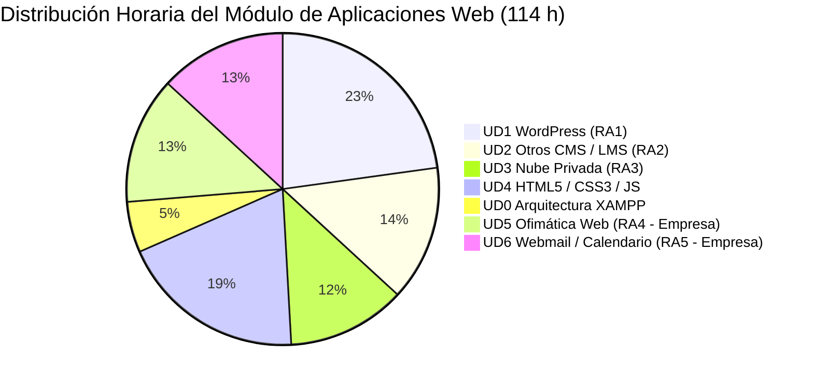

# 📅 Cronograma y Secuenciación Didáctica

El módulo profesional de **Aplicaciones Web (Código 0228)** cuenta con una carga horaria total de 84 horas lectivas presenciales en aula técnica (4 horas semanales), complementadas con 30 horas equivalentes integradas en la fase de formación en empresa (FEOE).

La planificación pedagógica ejerce la autonomía organizativa para articular el aprendizaje en **dos fases temporales diferenciadas**, garantizando la evaluación continua e integradora por Resultados de Aprendizaje (RA).

---

## 🏛️ Marco Normativo de Ordenación

::: info 📑 Regulaciones Autonómicas de Referencia
* **Orden de 7 de julio de 2009:** Desarrolla el currículo oficial del título de Técnico en Sistemas Microinformáticos y Redes en Andalucía (módulo 0228 con 84 h presenciales).
* **Decreto 147/2025, de 17 de septiembre:** Establece la ordenación general y la autonomía pedagógica de los centros docentes (Art. 14).
* **Orden de 18 de septiembre de 2025:** Regula los procesos de evaluación continua, calificación y titulación por Resultados de Aprendizaje.
* **Orden de 26 de septiembre de 2025:** Regula la fase de formación en empresa u organismo equiparado (FEOE).
  :::

---

## 🏫 FASE 1: Formación Lectiva Presencial en el Colegio Altair
**Calendario:** Septiembre a Marzo (Trimestres 1 y 2) | **Carga Horaria:** 84 horas lectivas presenciales (4 h/semana en aula técnica).

::: tip 🎯 Evaluación Criterial de la Fase 1
Durante esta fase se imparten y evalúan de forma continua los bloques de desarrollo local, administración de gestores de contenidos, plataformas de aprendizaje, nube privada y desarrollo cliente.
:::

### 🍂 Trimestre 1 (Septiembre – Diciembre)

| Unidad Didáctica | Horas | Bloque Técnico y Resultados de Aprendizaje |
| :--- | :---: | :--- |
| **UD0: Arquitectura Web y Entornos Locales de Desarrollo** | **6 h** | Cliente-servidor, protocolo HTTP/HTTPS, pila LAMP/WAMP y despliegue de **XAMPP** (Apache, MySQL, PHP). |
| **UD1 (Bloque 1): Gestores de Contenidos I (WordPress)** | **26 h** | Despliegue, maquetación FSE/Gutenberg, matriz de roles RBAC, plugins, *hardening* (`wp-config.php`/MySQL), backups y **Proyecto Integrador** *(Cubre RA1 completo)*. |

---

### ❄️ Trimestre 2 (Enero – Marzo)

| Unidad Didáctica | Horas | Bloque Técnico y Resultados de Aprendizaje |
| :--- | :---: | :--- |
| **UD2 (Bloque 2): Gestores de Contenidos II (Diversidad de CMS)** | **16 h** | Panorama de CMS, plataformas LMS (**Moodle**), e-commerce (**PrestaShop**) y generadores estáticos (**VitePress**) *(Cubre RA2 y amplía RA1)*. |
| **UD3 (Bloque 3): Almacenamiento Web y Nube Privada** | **14 h** | Despliegue de **Nextcloud**, cuotas de disco, carpetas compartidas, permisos y auditoría de accesos *(Cubre RA3 completo)*. |
| **UD4 (Bloque 4): Maquetación y Desarrollo Cliente** | **22 h** | Estructuración semántica en **HTML5**, diseño responsivo con **CSS3** (Flexbox/Grid) e introducción práctica a **JavaScript**. |

---

## 🏢 FASE 2: Formación Intensiva en Empresa (FEOE)
**Calendario:** Marzo a Junio (Trimestre 3) | **Permanencia:** 100 % en estancia laboral (30 h equivalentes dentro de las 250 h de estancia dual).

::: warning 💼 Integración Laboral sin Asistencia al Centro
Durante el tercer trimestre, el alumnado desarrolla su aprendizaje directamente en el entorno de producción de la empresa asignada, evaluándose de forma coordinada con la tutoría laboral.
:::

### ☀️ Trimestre 3 (Marzo – Junio)

| Unidad Didáctica | Horas Eq. | Ámbito Profesional y Resultados de Aprendizaje |
| :--- | :---: | :--- |
| **UD5 / FEOE (Empresa): Ofimática Web Colaborativa** | **15 h** | Herramientas de edición compartida en la nube, permisos de acceso y trabajo colaborativo corporativo *(Cubre RA4)*. |
| **UD6 / FEOE (Empresa): Aplicaciones Web de Escritorio** | **15 h** | Clientes de correo webmail, gestión de calendarios corporativos, citas y tareas compartidas *(Cubre RA5)*. |

---

## 📊 Resumen Horario Global del Módulo

    
| Fase | Horas Lectivas | Ubicación | Resultados de Aprendizaje Evaluados |
| :--- | :---: | :--- | :--- |
| Fase 1: Lectiva Presencial | 84 h | Colegio Altair (Aula Técnica) | RA1, RA2, RA3 y Desarrollo Cliente |
| Fase 2: Formación en Empresa | 30 h | Empresa Colaboradora | RA4 y RA5 |
| Total Módulo | 114 h | Global | 100 % RAs Cubiertos |

